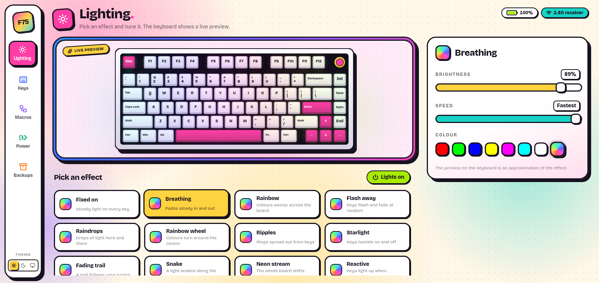
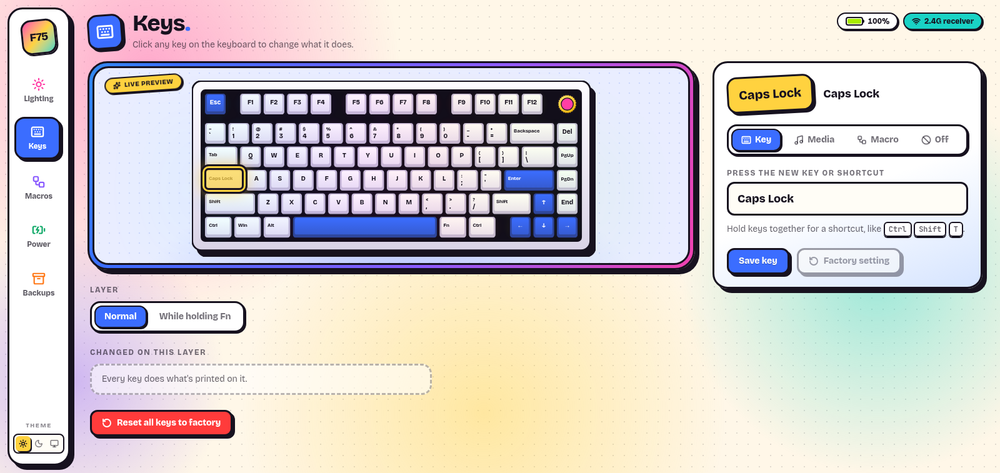
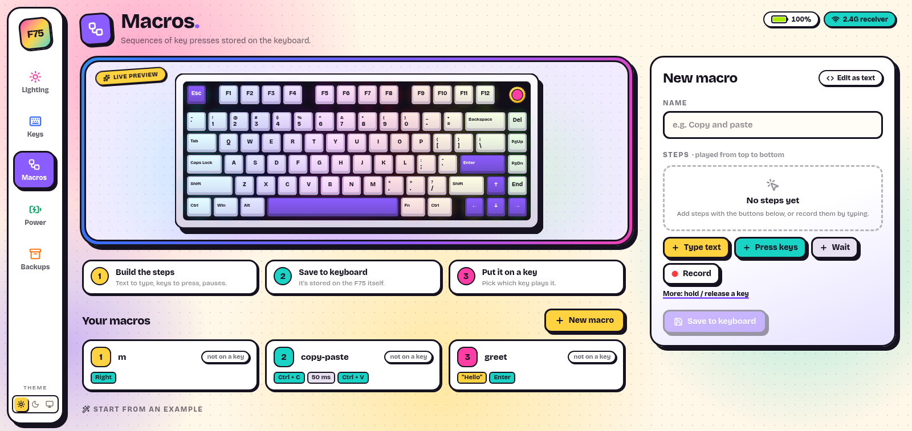
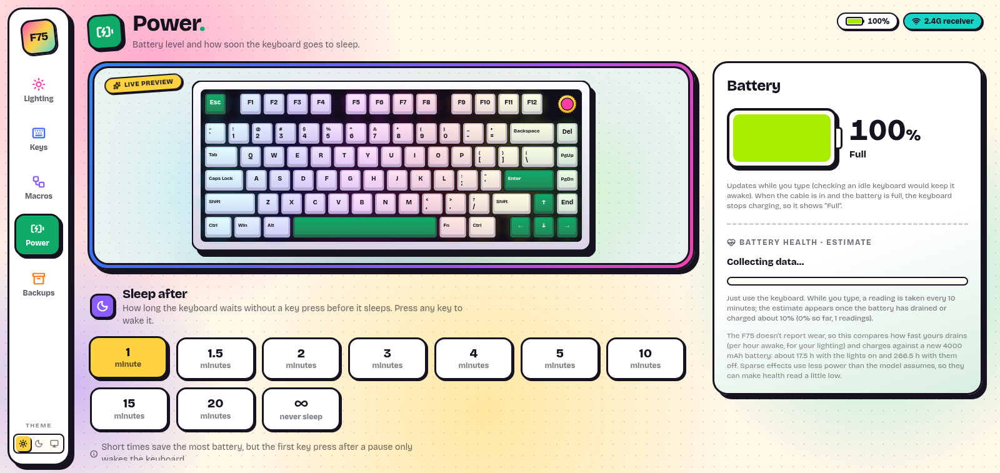
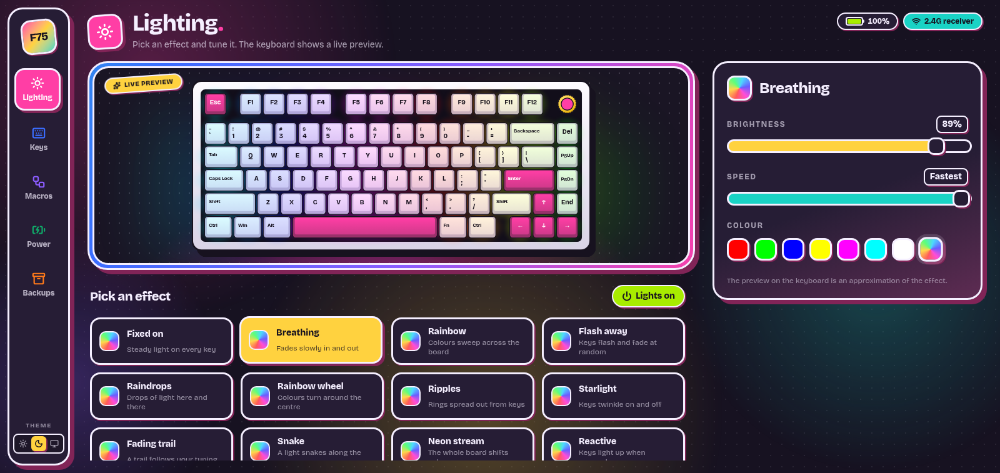

# AULA F75 for Linux

Control the lighting, key layout, macros, sleep timer and battery of the **AULA F75** mechanical keyboard on Linux, without the Windows-only vendor driver.

It comes as a desktop app with a live preview of your lighting, and as a command-line tool for scripts. Everything is saved to the keyboard itself, so your settings keep working on any computer.



## What's new

- **New look:** a bright, colourful interface built with Tailwind CSS, with **light and dark themes** and smooth transitions between sections.
- **Easier macros:** a step-by-step builder with examples and live recording, and a shortcut to put a macro on a key. Macros are now saved in the format the keyboard plays back.
- **Power section:** battery level and charging status, a battery health estimate, and the keyboard's sleep timer.
- **New commands:** `aula-f75 battery`, `aula-f75 sleep` and `aula-f75 battery-log`.
- **Safer device access:** the app, the command line and the battery logger take turns talking to the keyboard instead of interrupting each other.

## Features

- **Lighting:** all 18 built-in effects, plus brightness, speed, colour and lights off. You can edit the colour palette of each effect.
- **Live preview:** the app draws the keyboard and animates the chosen effect on every key.
- **Key remapping:** click a key and set it to another key, a shortcut (like `Ctrl+Shift+T`), a media action, a macro or nothing. You can remap both the normal layer and the **Fn** layer.
- **Macros:** build them from simple steps (type text, press a shortcut, wait, hold, release), start from an example, or record them live. They're stored on the keyboard and work without the app.
- **Battery:** charge level and charging status, updated while you type, with a low-battery warning.
- **Battery health estimate:** the keyboard doesn't report wear, so a small background logger compares how fast your battery drains and charges with a new 4000 mAh battery (see [Battery health](#battery-health)).
- **Sleep timer:** choose how long the keyboard waits before sleeping, from 1 to 20 minutes, or never.
- **Light and dark themes,** or follow the system setting.
- **Backups:** save and restore the lighting, colours, both key layers and macros in one file.
- **No root needed** once the udev rule is installed. The command-line tool has no dependencies beyond Python.

| Keys | Macros |
| --- | --- |
|  |  |
| **Power** | **Dark theme** |
|  |  |

## Supported hardware

| Connection | USB ID | Status |
| --- | --- | --- |
| 2.4 GHz receiver | `3554:fa09` | Tested: lighting, palette, remapping, macros, backup and restore, battery level. The sleep timer setting is new and not fully confirmed yet. |
| USB cable | `258a:010c` | Implemented, **not yet tested** |
| Bluetooth | none | Not supported (the vendor tool doesn't support it either) |

To check which one you have, plug in the keyboard and run:

```sh
lsusb | grep -Ei '3554:fa09|258a:010c'
```

If you test the USB cable connection, please open an issue with the result.

## Install

### 1. Requirements

| Needed for | Package |
| --- | --- |
| Everything | Python 3.8 or newer (standard library only) |
| The app window | A Chromium-based browser: Chromium, Google Chrome, Microsoft Edge, Brave or Vivaldi. A native package or a Flatpak both work. Without one, the app opens in your default browser. |
| Building the interface from source | Node.js 20 or newer, and pnpm (npm also works) |

Install them with your distribution's package manager:

```sh
# Arch, Manjaro, EndeavourOS
sudo pacman -S --needed python nodejs pnpm chromium

# Debian, Ubuntu, Linux Mint, Pop!_OS
sudo apt install python3 nodejs npm chromium      # Ubuntu ships Chromium as a snap

# Fedora
sudo dnf install python3 nodejs pnpm chromium

# openSUSE
sudo zypper install python3 nodejs npm chromium
```

If your distribution's Node.js is older than 20, install a newer one from [nodejs.org](https://nodejs.org/) or with a version manager such as `fnm` or `nvm`.

**Steam Deck, Fedora Atomic and other immutable systems:** Python is already there. Install a browser from Flatpak (for example `flatpak install flathub org.chromium.Chromium`). If you need Node.js to build the interface, use it inside a [Distrobox](https://distrobox.it/) container (see [Building from source](#building-from-source)).

### 2. Get the code

```sh
git clone 
cd AULA-F75-DRIVER-LINUX
```

### 3. Run the installer

```sh
./install.sh
```

The installer:

1. checks your Python version;
2. builds the interface if `app/static/` is missing (this needs Node.js);
3. installs a udev rule with `sudo`, so your user can reach the keyboard without root;
4. adds the `aula-f75` and `aula-f75-app` commands to `~/.local/bin`;
5. starts the battery logger as a systemd user service (for the [battery health estimate](#battery-health));
6. adds **AULA F75** to your application menu, under Settings.

| Option | What it does |
| --- | --- |
| `--build` | Rebuild the interface from `app/web` even if it's already built |
| `--no-udev` | Skip the udev rule (no sudo). You'll need root to reach the keyboard. |
| `--no-battery-log` | Don't install the background battery logger. Battery health then stays at "collecting data". |
| `--uninstall` | Remove the commands, menu entry, icon and udev rule. Your backups are kept. |

### 4. Check that it works

Unplug and replug the receiver or cable once, so the new udev rule applies. Then run:

```sh
aula-f75 info
```

You should see the connection type, the current lighting, the battery level and the sleep timer. Now open **AULA F75** from your application menu, or run `aula-f75-app`.

If `aula-f75` isn't found, `~/.local/bin` isn't on your `PATH`. Add this line to `~/.bashrc` or `~/.zshrc`:

```sh
export PATH="$HOME/.local/bin:$PATH"
```

## Building from source

The command-line tool and the backend are plain Python and need no building. Only the interface in `app/web` (Svelte 5 + Vite) is compiled, into `app/static`.

```sh
cd app/web
pnpm install        # or: npm install
pnpm build          # or: npm run build   -> writes ../static
```

Or let the installer do it for you:

```sh
./install.sh --build
```

**With Distrobox** (if you don't want Node.js on your host system):

```sh
distrobox create --name dev --image archlinux:latest
distrobox enter dev -- sudo pacman -S --needed --noconfirm nodejs pnpm
distrobox enter dev -- bash -lc 'cd /path/to/AULA-F75-DRIVER-LINUX/app/web && pnpm install && pnpm build'
./install.sh        # run on the host: the udev rule and menu entry belong to the host
```

Rebuild after you change anything in `app/web/src`, then restart the app.

## Using the app

| Section | What you can do |
| --- | --- |
| **Lighting** | Pick an effect, set brightness, speed and colour, and change any palette colour. The keyboard picture previews the effect live. It's an approximation of what the firmware does. |
| **Keys** | Choose the *Normal* layer or the *While holding Fn* layer, then click a key. Set it to a key or shortcut (press it in the box), a media action, a macro, or nothing. Changed keys are highlighted. |
| **Macros** | Add steps (*Type text*, *Press keys*, *Wait*, *Hold down*, *Release*), start from an example, or press **Record** and type. Power users can switch to text and write `"hello" enter` or `ctrl+c 50ms ctrl+v`. After saving, **Put it on a key** takes you to **Keys** with the macro ready to assign. |
| **Power** | See the battery level and the health estimate, and pick how long the keyboard waits before sleeping. |
| **Backups** | Save everything on the keyboard to `backups/`, or restore an earlier backup. |

The theme switch (light, dark or system) is at the bottom of the side bar.

The app runs a small local server on `127.0.0.1` and shows it in a browser app window. The server only accepts requests that carry a random token generated at each launch, so websites can't reach your keyboard. It quits by itself about 25 seconds after you close the window.

## Command line

```sh
aula-f75 info                          # connection, lighting, battery and sleep timer
aula-f75 modes                         # list effects and colours
aula-f75 set fixed -b 9 -c cyan        # static cyan at full brightness
aula-f75 set respire -s 3 -c rainbow   # breathing, speed 3, rainbow
aula-f75 set off
aula-f75 palette fixed                 # show the 7 colour slots of an effect
aula-f75 palette fixed 0 ff8800        # make slot 0 orange, then: aula-f75 set fixed -c 0
```

### Key remapping

```sh
aula-f75 keys                          # what every key does (normal layer)
aula-f75 keys --layer fn               # what each key does while holding Fn
aula-f75 keynames                      # every name you can remap to
aula-f75 remap capslock lctrl          # Caps Lock becomes Ctrl
aula-f75 remap rctrl lwin+e            # shortcuts: up to 2 keys plus modifiers
aula-f75 remap p play --layer fn       # Fn+P = play/pause
aula-f75 remap capslock default        # put one key back to factory
aula-f75 reset-keys                    # put every key back to factory
```

The Fn key itself can't be remapped, because you would lose access to the Fn layer.

### Macros

```sh
aula-f75 macro list
aula-f75 macro set 1 '"hello world" enter' --name greet
aula-f75 macro set 2 'ctrl+c 50ms ctrl+v'       # 50 ms pause after Ctrl+C
aula-f75 macro set 3 '+lshift a b -lshift'      # +key holds, -key releases
aula-f75 remap p macro:1 --layer fn             # Fn+P plays macro 1 once
aula-f75 remap f12 macro:2:times:3              # play 3 times
aula-f75 remap f11 macro:3:hold                 # repeat while held
aula-f75 remap f10 macro:3:toggle               # repeat until another key is pressed
aula-f75 macro delete 3                         # only the last macro can be deleted
```

Macro 0 (`m`, Right arrow) is the factory macro bound to Fn+F12.

### Battery and sleep

```sh
aula-f75 battery                   # charge level and the battery health estimate
aula-f75 sleep                     # how long the keyboard waits before sleeping
aula-f75 sleep 5                   # sleep after 5 minutes (1, 1.5, 2, 3, 4, 5, 10, 15 or 20)
aula-f75 sleep never               # never sleep (drains the battery much faster)
aula-f75 battery-log               # run the battery logger by hand (normally a user service)
```

### Backups

```sh
aula-f75 backup my-setup.json      # lighting, palette, both key layers and macros
aula-f75 restore my-setup.json
```

`factory-keys.json` holds the factory key layout and macros. `reset-keys` and `remap <key> default` use it.

## Battery health

The F75 only reports its charge level and whether it's charging. It has no wear counter, so the health shown is an **estimate**:

- The logger (`aula-f75 battery-log`, installed as the user service `aula-f75-battery`) takes a reading every 10 minutes **while you're typing**, into `~/.local/share/aula-f75/battery-log.jsonl`.
- It compares how many percent your battery uses per hour awake, for your brightness, with a new battery: 4000 mAh, about 17.5 hours with the default lighting and 266.5 hours with the lights off. It also compares how fast it charges (5 V, 700 mA) between 5% and 85%.
- A rough estimate appears after about 10% of drain or charge has been seen, and it gets better after 40%. One full drain and recharge gives the best result.

Effects that light only some keys use less power than the model assumes, so they can make the health read a little low.

Why only while typing? Every request to the keyboard counts as activity and resets its sleep timer. Checking an idle keyboard would keep it awake and drain the battery. For the same reason, the app reads the battery only while you type, and shows the last reading otherwise.

## Troubleshooting

| Problem | Fix |
| --- | --- |
| `Permission denied` or *keyboard not found* | Run `./install.sh` (or copy `70-aula-f75.rules` to `/etc/udev/rules.d/` and run `sudo udevadm control --reload-rules`), then replug the receiver. |
| *The keyboard didn't answer* | The keyboard goes to sleep over 2.4 GHz. Press any key to wake it, then try again. You can lengthen the sleep timer in **Power** or with `aula-f75 sleep 10`. |
| Battery health stays at "collecting data" | Check that the logger runs: `systemctl --user status aula-f75-battery`. If it's missing, run `./install.sh` again. |
| The app opens as a normal browser tab | No Chromium-based browser was found. Install one, or pick a specific one with `AULA_F75_BROWSER="flatpak run org.chromium.Chromium" aula-f75-app`. |
| The app doesn't appear in the menu | Log out and back in, or run `update-desktop-database ~/.local/share/applications`. |
| Something went wrong after a change | Restore a backup, or run `aula-f75 reset-keys` for the factory key layout. |

## How it works

This project came from reverse-engineering the vendor's Windows driver (`AULA F75 driver.exe`: an Inno Setup installer around `OemDrv.exe`). It contains no vendor code or images. It talks to the keyboard's vendor HID interface through `/dev/hidraw*`:

- **2.4 GHz receiver:** 20-byte HID reports (report ID `0x13`) carrying a command, a packet count and index, a payload of up to 14 bytes and an 8-bit checksum. The keyboard acknowledges every packet.
- **USB cable:** 520-byte feature reports (report ID `0x06`).
- **Data on the keyboard:** a 128-byte lighting block, a palette table, two 512-byte key layers (4 bytes per key) and a 512-byte macro page.
- **Sleep timer:** byte `0x18` of the lighting block, in 30-second steps (0 = never).
- **Battery:** read command `0x4A` returns the charge in percent and a flags byte (`0x10` = charging). The vendor tool doesn't show this for the F75.

The protocol details are documented in the docstring at the top of `aula_f75.py`.

## Project layout

```
aula_f75.py           command-line tool and protocol (stdlib only)
battery_health.py     battery log, health estimate and typing-activity watcher
factory-keys.json     factory key layers and macros
70-aula-f75.rules     udev rule for non-root access
install.sh            per-user installer
aula-f75-battery.service  systemd user service for the battery logger
app/aula-f75-app      launcher: starts the backend, opens the app window
app/server.py         local JSON API over aula_f75.py
app/web/              interface source (Svelte 5, Vite, Tailwind CSS 4)
app/static/           built interface (generated by the build)
docs/                 screenshots
```

### Development

- Debug options for the app URL: `&tab=keys&key=capslock` opens the Keys section (other tabs: `lighting`, `macros`, `power`, `backups`) with Caps Lock selected, `&debug=1` outlines the clickable keys, and `&preview=rainbow-wheel` previews an effect without writing it to the keyboard.
- The keyboard drawing is generated from `app/web/src/lib/layout.js`, and the lighting preview comes from `app/web/src/lib/effects.js`.
- Not implemented yet: per-key custom lighting, and the screen/GIF features of other AULA models.

## License

[MIT](LICENSE). The interface bundles the Bricolage Grotesque and JetBrains Mono fonts (both under the SIL Open Font License, via Fontsource) and Lucide icons (ISC License).

## Disclaimer

This is an unofficial project. It is not affiliated with or endorsed by AULA. It writes to your keyboard's on-board memory, so take a backup before experimenting. You use it at your own risk.
